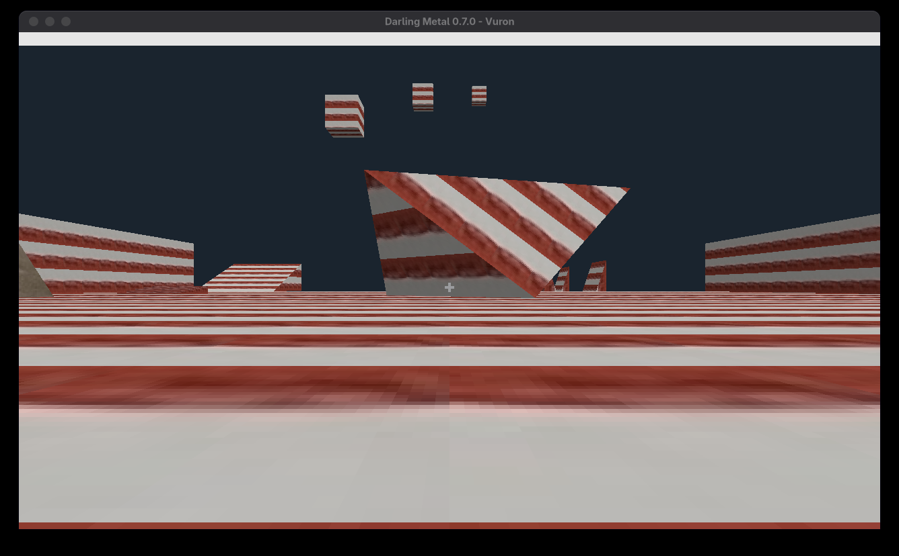
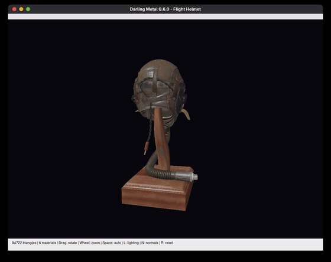

# Darling Metal API

**Experimental Metal compatibility work for Linux — now running a playable, GPU-rendered 3D game.**

[Download v0.7.0](https://github.com/GigaDarling/darling-metalapi/releases/tag/v0.7.0) · [Build from source](#build-from-source) · [Validation](VALIDATION.md) · [Русский](README.ru.md)



Vuron's C++ game, Metal renderer, shader and arena run as a Mach-O application
inside Darling. Keyboard, mouse look, jumping, grapple and weapons were tested
interactively. The scene is rendered by the GPU through **Metal → Indium → Vulkan**.

This project builds on [Darling](https://github.com/darlinghq/darling),
[darling-metal](https://github.com/darlinghq/darling-metal),
[Indium](https://github.com/darlinghq/indium) and
[mslc](https://github.com/cristim/mslc). It packages compatibility changes,
reproducible demos and tests around that stack. Vuron is the existing
[MIT-licensed game by Varun Verma](https://github.com/VanadiumVox/Vuron).

## See it running



[Watch the short renderer showcase](docs/media/showcase-v0.7.0.mp4).
The clips show actual application windows, including a static view of Vuron’s arena.

| Demo | What works | Details |
| --- | --- | --- |
| **Vuron** | GPU-rendered 3D arena, textures, directional/point lighting, mouse look, keyboard, grapple and rockets | [Game integration](demo/vuron/README.md) |
| **Flight Helmet** | 94,722 triangles, six materials, 15 textures, normal maps, metallic/roughness and interactive camera | [Model viewer](demo/model/README.md) |
| **Apple Metal sample** | Official CPU/GPU synchronization sample, native AppKit menus, controls and mouse input | [Sample integration](demo/apple-sync/README.md) |
| **DOOM** | DoomGeneric gameplay, keyboard and sound effects; its software-rendered frame is presented through Metal | [DOOM integration](demo/doom/README.md) |
| **API demos** | Animated shapes, indexed 3D cube, material previews, dynamic light and read/write textures | [API tests](demo/README.md) |

## Try the binary build

The release is a **Linux x86_64 overlay**, not a complete Darling installation.
You need a matching **Darling GUI runtime**, built from the pinned revisions in
[upstream.json](upstream.json). The tested host is Arch Linux with glibc 2.44,
LLVM 23.1.5 and Intel Iris Xe. Window rendering needs Vulkan 1.3 and OpenGL on
the same GPU. Host libraries, including the matching libLLVM major, are external.
Rootless user namespaces and subordinate UID/GID ranges must be configured.

Download and extract `darling-metalapi-v0.7.0-linux-x86_64.tar.gz` from
[Releases](https://github.com/GigaDarling/darling-metalapi/releases/tag/v0.7.0),
then run these commands inside the extracted directory. Replace the prefix with
an installation containing `bin/darling`, and choose the ICD for your GPU:

```sh
python3 install-overlay.py --prefix /path/to/darling-prefix --dry-run
python3 install-overlay.py --prefix /path/to/darling-prefix
python3 run.py vuron-window \
  --darling-prefix /path/to/darling-prefix \
  --icd /usr/share/vulkan/icd.d/intel_icd.json
```

Close applications using that installation before applying the overlay.
The installer backs up replaced files inside the prefix and does not use sudo.
Each launch gets its own temporary DPREFIX.

**Vuron controls:** click to capture the mouse; **Escape** releases it.
**WASD** moves, mouse looks, **Space** jumps, **Shift** crouches, **left mouse**
grapples/fires, hold **G** to switch weapon, **right mouse** parries.

The model is bundled too:

```sh
python3 run.py model-window \
  --darling-prefix /path/to/darling-prefix \
  --icd /usr/share/vulkan/icd.d/intel_icd.json
```

## Build from source

Install Darling's host build dependencies, Vulkan headers/tools, LLVM/Clang,
CMake, Ninja, `patch` and Python with Pillow. Use a clean checkout: integration
refuses to overwrite local changes. The scripts fetch pinned, openly licensed
Vuron, DoomGeneric and Flight Helmet dependencies.

```sh
git clone --recurse-submodules https://github.com/GigaDarling/darling-metalapi.git
cd darling-metalapi
git clone https://github.com/darlinghq/darling.git work/darling
git -C work/darling checkout b5e94cd7347616c015e327711028d48a1a459888
git -C work/darling submodule update --init --recursive
python3 prepare.py --darling work/darling --check
python3 prepare.py --darling work/darling
python3 build.py --darling work/darling --jobs 4
python3 run.py vuron-window \
  --darling-prefix work/darling/build/metal-baseline/prefix \
  --demo work/darling/build/metal-baseline/darling/src/tools/vuron/vuron.app/Contents/MacOS/vuron-game \
  --icd /usr/share/vulkan/icd.d/intel_icd.json
```

The build installs inside `work/darling/build/metal-baseline/prefix`. A full
Darling GUI build takes several gigabytes and substantial compilation time.

## Tested behavior, with upstream contributions

- **Fragment derivatives:** 43,200 produced-value comparisons per driver on
  Intel Iris Xe and lavapipe; an axis-swap negative control fails as expected.
- **3D geometry and depth:** three camera/aspect cases, independent CPU ray/triangle
  checks, reversed draw order and a blank-image negative control.
- **Native UI:** regression checks for menus, focus transfers, popups and alerts.
- **Upstream:** [Indium PR #33](https://github.com/darlinghq/indium/pull/33), fixing
  viewport Y translation, is merged. [PR #43](https://github.com/darlinghq/indium/pull/43)
  addresses completion-handler synchronization and is open.

See [VALIDATION.md](VALIDATION.md) for the measured scope and
[THIRD-PARTY-NOTICES.md](THIRD-PARTY-NOTICES.md) for licenses and provenance.

## Current scope

This is a tested subset of Metal compatibility, not general macOS game support.
Vuron is an early movement/shooter sandbox. The model viewer supports static,
opaque glTF/GLB geometry; refraction, IBL and skeletal animation are not implemented.
DOOM needs an external IWAD; music is not implemented. The newer 0.8 rendering
experiments are separate from this 0.7.0 release.

GPU/driver reports and small, reproducible API tests are welcome. Include your
host distribution, GPU, ICD, exact launch command and expected/actual behavior.
