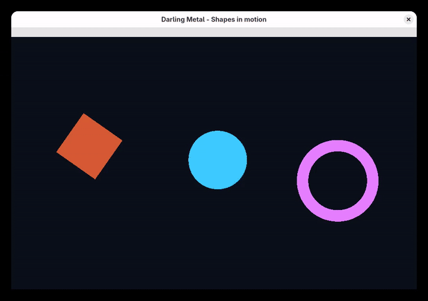
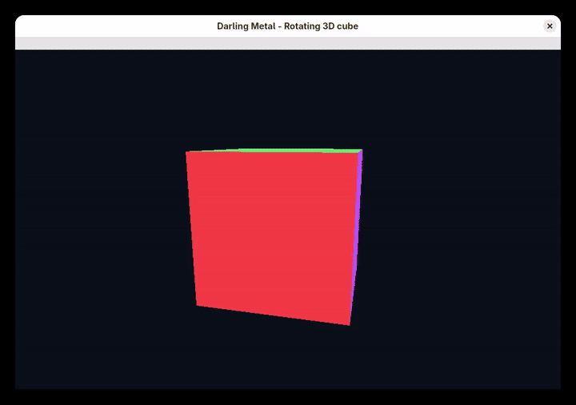

# darling-metalapi

Экспериментальная реализация части Apple Metal API в Linux через Darling,
Indium и Vulkan. Компиляция MSL из исходного текста через mslc, простые фигуры,
анимация и проверка результата чтением пикселей с GPU.



**[Видео реального окна — MP4](docs/media/shapes-animation.mp4)** ·
**[Скриншот](docs/media/shapes-window.png)** ·
**[Сборки и видео в Releases](https://github.com/japNslow/darling-metalapi/releases)**

## Что работает

- Публичный `newLibraryWithSource:options:error:` для поддерживаемого подмножества MSL.
- Vertex, fragment и compute entry points, поиск функций и сообщения об ошибках.
- Буферы, включая разреженные Metal indices: геометрия в 3, uniforms в 7,
  отдельная проверка compute-записи в 5.
- Квадрат, заполненный круг и кольцо; движение, вращение, пульсация размера и цвета.
- Реальное окно MTKView/CAMetalLayer, resize и закрытие.
- Offscreen-проверка четырёх временных точек: 1 012 986 проверенных пикселей,
  ноль несовпадений вне границ геометрии.

Это развитие открытого [darling-metal](https://github.com/darlinghq/darling-metal),
а не оригинальная проприетарная библиотека Apple. Основные графические команды
уже реализованы upstream; наши изменения добавляют исходную компиляцию через
mslc, адаптацию buffer reflection, исправление ранней инициализации слоя NSView
и проверяемое демо. Это не полная реализация Metal.

Textures/samplers в source bridge и пользовательские compile options пока
возвращают Unsupported. Сглаживание и прозрачность не заявляются как
проверенные возможности этой демонстрации. [Карта возможностей](docs/UPSTREAM-STUDY.md).
Результаты проверки релиза — в [VALIDATION.md](VALIDATION.md).

## Новая 3D-сцена из исходников

В текущие исходники добавлен вращающийся цветной куб: 24 вершины, 36 индексов,
перспектива 55°, GPU-вращение вокруг двух осей и depth buffer Depth32Float.


После сборки из исходников запустите:

```sh
python3 run.py cube-window \
  --darling-prefix work/darling/build/metal-baseline/prefix \
  --demo work/darling/build/metal-baseline/darling/src/tools/metal-baseline-demo \
  --icd /usr/share/vulkan/icd.d/intel_icd.json
```

Для проверки доступны `cube-offscreen` и `cube-window-test`.
Проверены четыре момента анимации, разные пропорции кадра, обратный порядок
граней и обнаружение отключённого depth test. Каждый порядок рисования дал
ноль несовпадений на 1 212 376 пикселях вне зоны рёбер. Подробнее —
[demo/README.md](demo/README.md#rotating-3d-cube).
Готовый архив v0.1.0 содержит предыдущую 2D-демонстрацию; для куба нужна
сборка текущих исходников.

## Готовая сборка v0.1.0

В Releases находится **binary overlay Linux x86_64**, включающий Metal,
MetalKit, исправленный AppKit, Indium/Iridium и Mach-O demo.
**Полный runtime Darling в архив не входит.** Нужен Darling GUI из закреплённой
ревизии, собранный с `ENABLE_METAL=ON`; произвольные системные версии могут
быть несовместимы. Ревизии перечислены в `upstream.json`.

Сборка проверена на Arch Linux, glibc 2.44, LLVM 23.1.5 и Intel Iris Xe с Mesa.
Нужны Vulkan 1.3, timeline semaphores и совместимый драйвер OpenGL для окна.
Зависимости хоста, включая libLLVM того же major, не упакованы.
Runner использует rootless user namespaces, `unshare`, `setpriv`,
`newuidmap`/`newgidmap` и настроенные subordinate UID/GID ranges.

Распакуйте `darling-metalapi-v0.1.0-linux-x86_64.tar.gz`. В командах ниже
`/path/to/darling-prefix` — каталог установки Darling, содержащий `bin/darling`,
а не пользовательский DPREFIX. Остановите приложения, использующие эту установку.

```sh
python3 install-overlay.py --prefix /path/to/darling-prefix --dry-run
python3 install-overlay.py --prefix /path/to/darling-prefix
python3 run.py shapes-window --darling-prefix /path/to/darling-prefix \
  --icd /usr/share/vulkan/icd.d/intel_icd.json
```

Установщик сохраняет заменяемые файлы в `.darling-metalapi-backup-*` внутри
prefix. Он не использует sudo. Выберите ICD своего GPU: Vulkan и OpenGL должны
использовать совместимое устройство. Для другого GPU путь Intel из примера
нужно заменить.

```sh
python3 run.py shapes-offscreen --darling-prefix /path/to/darling-prefix \
  --icd /usr/share/vulkan/icd.d/intel_icd.json
python3 run.py shapes-window-test --darling-prefix /path/to/darling-prefix \
  --icd /usr/share/vulkan/icd.d/intel_icd.json
```

`shapes-offscreen` проверяет фиксированные кадры и сохраняет PPM в `results/`.
`shapes-window-test` проверяет изменение размеров и закрывает окно.
`offscreen` дополнительно проверяет исходный треугольник.
Runner создаёт отдельный временный DPREFIX и удаляет его после выхода.

## Сборка из исходников

Сначала установите зависимости сборки [Darling](https://github.com/darlinghq/darling)
для вашего дистрибутива, а также Vulkan SDK/headers, LLVM/Clang, CMake и Ninja.
Рекомендуется отдельный чистый checkout: `prepare.py` отказывается перезаписывать
локальные изменения в изменяемых подмодулях.

```sh
git clone --recurse-submodules https://github.com/japNslow/darling-metalapi.git
cd darling-metalapi
git clone https://github.com/darlinghq/darling.git work/darling
git -C work/darling checkout b5e94cd7347616c015e327711028d48a1a459888
git -C work/darling submodule update --init --recursive
python3 prepare.py --darling work/darling --check
python3 prepare.py --darling work/darling
python3 build.py --darling work/darling --jobs 4
python3 run.py shapes-window \
  --darling-prefix work/darling/build/metal-baseline/prefix \
  --demo work/darling/build/metal-baseline/darling/src/tools/metal-baseline-demo \
  --icd /usr/share/vulkan/icd.d/intel_icd.json
```

Сборка устанавливается внутрь `work/darling/build/metal-baseline/prefix`.
Системная установка не выполняется. Полная сборка Darling требует нескольких
гигабайт диска и заметного времени. Подробные команды native-проверок и история
результатов — в [demo/README.md](demo/README.md).

## Состав и происхождение

- `metal/`: исходники darling-metal с нашими изменениями; MPL-2.0 notices сохранены.
- `metal/deps/indium`: закреплённый открытый backend, 0BSD.
- `deps/mslc`: закреплённый открытый компилятор, MIT.
- `demo/`: самостоятельно написанное GPL-3.0-or-later демо и проверки.
- `patches/`: интеграция в Darling, исправление NSView и совместимость
  darlingserver с публичными OpenSSL 4 API.
- `docs/media/`: снимок и шестисекундная запись настоящего окна, захват 15 FPS.

Исходники и исходные ревизии доступны в этом репозитории и его подмодулях.
В binary overlay включены исходники GPL-демо и тексты лицензий.
См. [THIRD-PARTY-NOTICES.md](THIRD-PARTY-NOTICES.md) и `upstream.json`.

Источники изменений: публичные API Metal/NSView, интерфейс mslc и открытый
интерфейс Indium. Ограниченные исходники Apple, CoreCrypto, дизассемблирование
и декомпиляция Apple binaries не использовались. Примерные 58 FPS в коротком
локальном прогоне не являются гарантией производительности.
