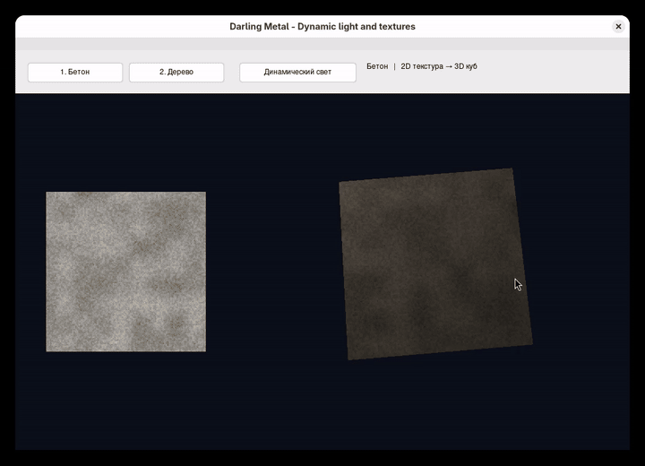
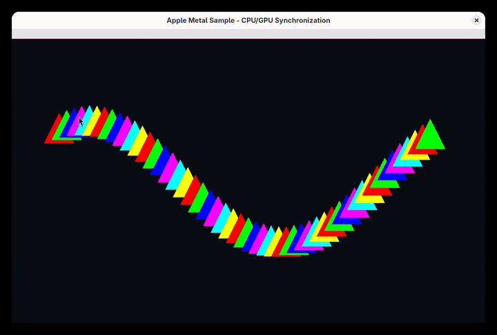
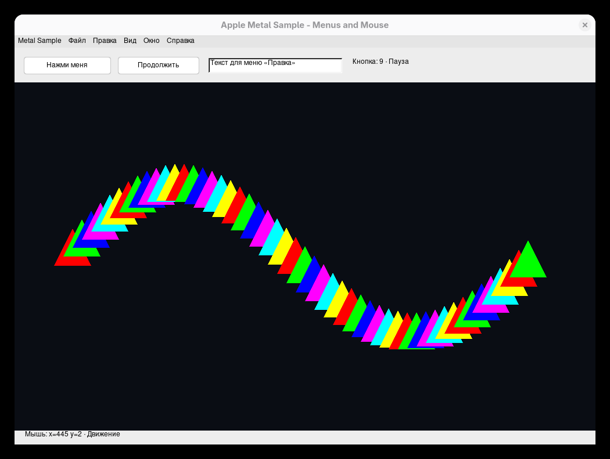

# darling-metalapi

Экспериментальная реализация части Apple Metal API в Linux через Darling,
Indium и Vulkan. Компиляция MSL из исходного текста через mslc, простые фигуры,
анимация и проверка результата чтением пикселей с GPU.



**[Видео реального окна — MP4](docs/media/lighting-animation.mp4)** ·
**[Скриншот](docs/media/lighting-window.png)** ·
**[Сборки и видео в Releases](https://github.com/GigaDarling/darling-metalapi/releases)**

## Новое в v0.4.0: официальный sample Apple и AppKit

Запускается [Synchronizing CPU and GPU Work](https://developer.apple.com/documentation/metal/synchronizing-cpu-and-gpu-work):
50 цветных треугольников движутся волной; renderer использует три буфера кадров,
семафор и completion handlers. Шесть файлов renderer/shader взяты **без изменений**
из официального ZIP, SHA-256 закреплён, MIT license и copyright сохранены.
Наши части — AppKit bootstrap, CMake, открытый формат библиотеки и проверки.
Это сборка официального исходного примера нашим компилятором, не запуск готовой
Apple AIR-библиотеки или Xcode-проекта без адаптации.



После локальной сборки:

```sh
python3 run.py apple-window \
  --darling-prefix work/darling/build/metal-baseline/prefix \
  --demo work/darling/build/metal-baseline/darling/src/tools/apple-metal-sample.app/Contents/MacOS/apple-metal-sample \
  --icd /usr/share/vulkan/icd.d/intel_icd.json
```

В окне также работают настоящие меню **Файл / Правка / Вид / Окно / Справка**,
кнопка со счётчиком, пауза кликом или пробелом, шаг по кадрам и меню по ПКМ.
Текстовое поле поддерживает стандартные команды редактирования.



Проверки: `apple-library-test` и `apple-window-test` с теми же путями.
Регрессии выбора меню и фокуса выполняются через `demo/apple-sync/check-private-x11.py`
на отдельном Xvfb, не затрагивая рабочий стол.
На Intel проверено 442 692 пикселя четырёх кадров/трёх размеров, ноль несовпадений;
36 негативных теста формата библиотеки проходят. Подробности, изменения сборки
и происхождение кода — [demo/apple-sync/README.md](demo/apple-sync/README.md).
**[Релиз v0.4.0](https://github.com/GigaDarling/darling-metalapi/releases/tag/v0.4.0)** включает готовый sample и исправления AppKit/X11.
[Видео MP4](docs/media/apple-sync-animation.mp4) · [Скриншот](docs/media/apple-sync-window.png).

## Что работает

- Публичный `newLibraryWithSource:options:error:` для поддерживаемого подмножества MSL.
- Vertex, fragment и compute entry points, поиск функций и сообщения об ошибках.
- Буферы, включая разреженные Metal indices: геометрия в 3, uniforms в 7,
  отдельная проверка compute-записи в 5.
- Квадрат, заполненный круг и кольцо; движение, вращение, пульсация размера и цвета.
- Реальное окно MTKView/CAMetalLayer, resize и закрытие.
- Offscreen-проверка четырёх временных точек: 1 012 986 проверенных пикселей,
  ноль несовпадений вне границ геометрии.

Это развитие открытого [darling-metal](https://github.com/darlinghq/darling-metal),
а не оригинальная проприетарная библиотека Apple. Основные графические команды
уже реализованы upstream; наши изменения добавляют исходную компиляцию через
mslc, адаптацию buffer reflection, исправление ранней инициализации слоя NSView
и проверяемое демо. Это не полная реализация Metal.

Source bridge поддерживает sampled textures, отдельные и встроенные `constexpr` samplers,
а также `texture2d` с `access::read`, `write`, `read_write`. Произвольные
compile options, массивы/кубические storage textures и mip-операции не заявлены. Сглаживание и прозрачность не заявляются как
проверенные возможности этой демонстрации. [Карта возможностей](docs/UPSTREAM-STUDY.md).
На lavapipe storage-ядра проходят, но material nearest-sampling пока даёт
расхождение в проверке угла; полная сцена проверена на Intel Iris Xe.
Результаты проверки релиза — в [VALIDATION.md](VALIDATION.md).

## Новое в v0.3.0

- Движущийся точечный источник света: нормали граней, Lambert diffuse,
  ambient и затухание по расстоянию. Кнопка **Динамический свет** включает
  освещение куба; плоское превью показывает исходную текстуру.
- Текстуры материалов загружаются compute-ядром через `access::write`.
  `access::read_write` в mslc и Indium проверен настоящим изменением пикселей
  на месте и обратным проходом. GPU-проверка: RGBA8Unorm, 8×8 и 7×5.
- Встроенный `constexpr sampler` с linear/repeat работает независимо
  от внешнего sampler binding. Сохранены отдельные nearest/linear проверки.
- Интегрированы 14 новых коммитов darling-metal до
  [`643f571`](https://github.com/darlinghq/darling-metal/commit/643f57199d7b9eb5246a79e7568ffe6c7ad9e723):
  lazy initialization, дополнительные value API, enqueue/waitUntilScheduled,
  compile-options properties и исправления публичных заголовков.
- mslc: 2 573 теста прошли; исходный Indium shader corpus — 7/7 до и после.

`prepare.py` применяет включённый `patches/mslc-read-write.patch` к отдельной
копии закреплённого MIT-компилятора в checkout Darling; оригинальный подмодуль
`deps/mslc` остаётся нетронутым. Это локальная доработка для открытой
[задачи mslc #96](https://github.com/cristim/mslc/issues/96), а не заявление,
что изменение уже принято upstream.

## Новая 3D-сцена из исходников

В текущие исходники добавлен вращающийся цветной куб: 24 вершины, 36 индексов,
перспектива 55°, GPU-вращение вокруг двух осей и depth buffer Depth32Float.


После сборки из исходников запустите:

```sh
python3 run.py cube-window \
  --darling-prefix work/darling/build/metal-baseline/prefix \
  --demo work/darling/build/metal-baseline/darling/src/tools/metal-baseline-demo \
  --icd /usr/share/vulkan/icd.d/intel_icd.json
```

Для проверки доступны `cube-offscreen` и `cube-window-test`.
Проверены четыре момента анимации, разные пропорции кадра, обратный порядок
граней и обнаружение отключённого depth test. Каждый порядок рисования дал
ноль несовпадений на 1 212 376 пикселях вне зоны рёбер. Подробнее —
[demo/README.md](demo/README.md#rotating-3d-cube).
Куб, текстуры и динамический свет включены в готовый архив v0.3.0.

## Выбор текстур: бетон и дерево

В режиме `textures-window` кнопки **1. Бетон** и **2. Дерево** переключают
одну и ту же текстуру на плоском превью слева и вращающемся кубе справа.
Процедурные RGBA-текстуры 512×512 написаны самостоятельно; на каждой грани
размещены UV-координаты 0..1. Включены линейная фильтрация и depth buffer.

[Бетон — кадр с GPU](docs/media/materials-concrete.png) ·
[Дерево — кадр с GPU](docs/media/materials-wood.png)

Проверены загрузка 2×2 с различимыми углами, nearest/linear, одновременные
fragment buffer 6 / texture 2 / sampler 4, UV на кубе и переключение материалов.
Четыре сцены дали ноль несовпадений с CPU-эталоном на 129 422 проверенных
отсчётах. Проверка другим материалом намеренно обнаруживает расхождения.
Режимы проверки: `textures-offscreen` и `textures-window-test`.

## Готовая сборка v0.4.0

В Releases находится **binary overlay Linux x86_64**, включающий Metal,
MetalKit, исправленный AppKit и его X11 backend, Indium/Iridium, Mach-O demo
и приложение официального sample Apple.
**Полный runtime Darling в архив не входит.** Нужен Darling GUI из закреплённой
ревизии, собранный с `ENABLE_METAL=ON`; произвольные системные версии могут
быть несовместимы. Ревизии перечислены в `upstream.json`.

Сборка проверена на Arch Linux, glibc 2.44, LLVM 23.1.5 и Intel Iris Xe с Mesa.
Нужны Vulkan 1.3, timeline semaphores и совместимый драйвер OpenGL для окна.
Зависимости хоста, включая libLLVM того же major, не упакованы.
Для сборки из исходников также нужна утилита `patch`.
Runner использует rootless user namespaces, `unshare`, `setpriv`,
`newuidmap`/`newgidmap` и настроенные subordinate UID/GID ranges.

Распакуйте `darling-metalapi-v0.4.0-linux-x86_64.tar.gz`. В командах ниже
`/path/to/darling-prefix` — каталог установки Darling, содержащий `bin/darling`,
а не пользовательский DPREFIX. Остановите приложения, использующие эту установку.

```sh
python3 install-overlay.py --prefix /path/to/darling-prefix --dry-run
python3 install-overlay.py --prefix /path/to/darling-prefix
python3 run.py apple-window --darling-prefix /path/to/darling-prefix \
  --icd /usr/share/vulkan/icd.d/intel_icd.json
```

Установщик сохраняет заменяемые файлы в `.darling-metalapi-backup-*` внутри
prefix. Он не использует sudo. Выберите ICD своего GPU: Vulkan и OpenGL должны
использовать совместимое устройство. Для другого GPU путь Intel из примера
нужно заменить.

```sh
python3 run.py shapes-offscreen --darling-prefix /path/to/darling-prefix \
  --icd /usr/share/vulkan/icd.d/intel_icd.json
python3 run.py shapes-window-test --darling-prefix /path/to/darling-prefix \
  --icd /usr/share/vulkan/icd.d/intel_icd.json
```

`shapes-offscreen` проверяет фиксированные кадры и сохраняет PPM в `results/`.
`shapes-window-test` проверяет изменение размеров и закрывает окно.
`offscreen` дополнительно проверяет исходный треугольник.
Runner создаёт отдельный временный DPREFIX и удаляет его после выхода.

## Сборка из исходников

Сначала установите зависимости сборки [Darling](https://github.com/darlinghq/darling)
для вашего дистрибутива, а также Vulkan SDK/headers, LLVM/Clang, CMake и Ninja.
Рекомендуется отдельный чистый checkout: `prepare.py` отказывается перезаписывать
локальные изменения в изменяемых подмодулях.

```sh
git clone --recurse-submodules https://github.com/GigaDarling/darling-metalapi.git
cd darling-metalapi
git clone https://github.com/darlinghq/darling.git work/darling
git -C work/darling checkout b5e94cd7347616c015e327711028d48a1a459888
git -C work/darling submodule update --init --recursive
python3 prepare.py --darling work/darling --check
python3 prepare.py --darling work/darling
python3 build.py --darling work/darling --jobs 4
python3 run.py shapes-window \
  --darling-prefix work/darling/build/metal-baseline/prefix \
  --demo work/darling/build/metal-baseline/darling/src/tools/metal-baseline-demo \
  --icd /usr/share/vulkan/icd.d/intel_icd.json
```

Сборка устанавливается внутрь `work/darling/build/metal-baseline/prefix`.
Системная установка не выполняется. Полная сборка Darling требует нескольких
гигабайт диска и заметного времени. Подробные команды native-проверок и история
результатов — в [demo/README.md](demo/README.md).

## Состав и происхождение

- `metal/`: исходники darling-metal с нашими изменениями; MPL-2.0 notices сохранены.
- `metal/deps/indium`: закреплённый открытый backend, 0BSD.
- `deps/mslc`: закреплённый открытый компилятор, MIT.
- `demo/`: GPL-3.0-or-later демо и проверки, а также официальный MIT sample Apple с сохранённой лицензией.
- `patches/`: интеграция в Darling, исправления NSView, меню и X11-фокуса, совместимость
  darlingserver с публичными OpenSSL 4 API.
- `docs/media/`: снимок и шестисекундная запись настоящего окна, захват 15 FPS.

Исходники и исходные ревизии доступны в этом репозитории и его подмодулях.
В binary overlay включены исходники GPL-демо и тексты лицензий.
См. [THIRD-PARTY-NOTICES.md](THIRD-PARTY-NOTICES.md) и `upstream.json`.

Источники изменений: публичные API Metal/AppKit, документация Xlib, официальный
MIT sample Apple, интерфейс mslc и открытый интерфейс Indium. Ограниченные исходники Apple, CoreCrypto, дизассемблирование
и декомпиляция Apple binaries не использовались. Примерные 58 FPS в коротком
локальном прогоне не являются гарантией производительности.
